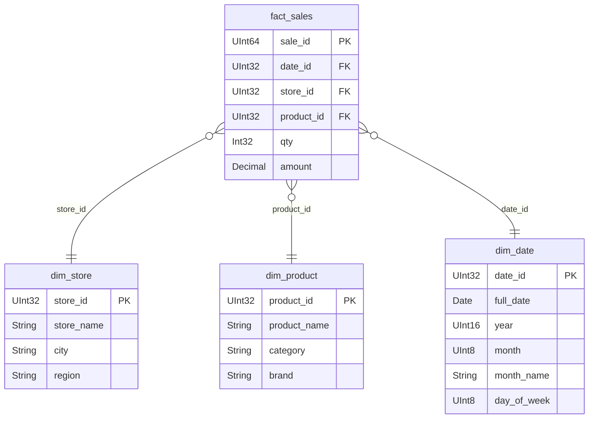

# Паспорт модели: розничные продажи

- **ФИО:** _<впишите>_
- **Группа:** _<впишите>_
- **Домен:** розница (`retail_dw`)
- **Сырьё:** `data/raw/` (см. [data/raw/README.md](data/raw/README.md))

## Что означает одна строка факта

> **Одна строка `fact_sales` = одна позиция в чеке: один товар в одном магазине в один день, с количеством и суммой.**

Как проверить таблицу по этой фразе:
- `sale_id` уникален (одна позиция — одна строка);
- у строки ровно один `store_id`, один `product_id` и один `date_id`;
- `qty` и `amount` относятся к этой позиции целиком, а не к чеку или дню.

В sample нет номера чека, поэтому «позиция в чеке» здесь означает «продажа товара в магазине за день». Если в своих данных появится `receipt_id`, зерно уточню.

## Таблицы

| Таблица | Роль | Ключ | Что хранит |
|---------|------|------|------------|
| `fact_sales` | факт | `sale_id` | события продаж и числа |
| `dim_store` | справочник | `store_id` | магазин, город, регион |
| `dim_product` | справочник | `product_id` | товар, категория, бренд |
| `dim_date` | справочник | `date_id` (YYYYMMDD) | дата, год, месяц, день недели |

## Меры

| Мера | Можно просто `SUM`? | Комментарий |
|------|---------------------|-------------|
| `amount` — сумма продажи | да | основная мера, суммируется по любым разрезам |
| `qty` — количество | да | суммируется по любым разрезам |
| цена за штуку = `amount / qty` | **нет** | в таблице не хранится. По группе считать как `sum(amount) / sum(qty)`, а не среднее цен |

## Главная метрика

**Оборот** = сумма `amount` по всем строкам факта. Возвратов в данных нет, поэтому «оборот без возвратов» совпадает с общим оборотом.

Эталонный запрос лежит в [sql/canonical_metric.sql](sql/canonical_metric.sql), здесь тот же текст:

```sql
SELECT sum(amount) AS turnover
FROM fact_sales;
-- на sample: 264.00
```

(В ClickHouse таблица называется `retail_dw.fact_sales`, в DuckDB просто `fact_sales`.)

## Схема star



## История справочников

| Справочник | Решение | Почему |
|------------|---------|--------|
| `dim_product` | **SCD2** (храним историю) | категория и бренд товара могут меняться, а старые продажи должны остаться в старой категории. Реализация на З06 |
| `dim_store` | **SCD1** (затираем старое) | название магазина или регион при исправлении ошибки достаточно перезаписать |
| `dim_date` | **пока не трогаем** | календарь не меняется |

Если на З06 решу не делать SCD2, оформлю это отказом в `cut.md`.

## Три вопроса для SQL

1. Какой оборот по регионам за январь 2024? _(sample: Центр 73.00, Запад 52.50)_
2. Какие категории товаров дают наибольший оборот за весь период? _(sample: Молочка 129.00, Напитки 111.00, Хлеб 18.00, Бакалея 6.00)_
3. Как менялись оборот и количество проданных единиц по месяцам? _(sample: январь 125.50 / 65, февраль 78.50 / 29, март 60.00 / 50)_

Запросы на эти вопросы: [sql/analytics.sql](sql/analytics.sql) (вопрос 1, 2 и 3 по порядку).
