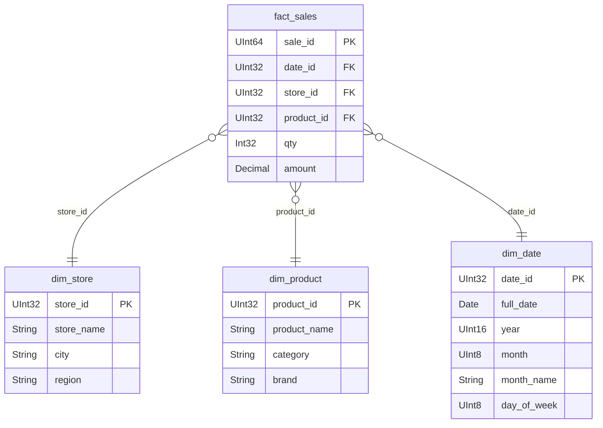

# Паспорт витрины (P02 / зачёт)

ФИО: Тарасов Павел Витальевич · Дата: 30.10.2026 · Домен: розница (`retail_dw`)

Сырьё: `data/raw/` (поля описаны в [data/raw/README.md](data/raw/README.md)).

## 1. Бизнес-цель витрины (1–2 предложения)

Показать руководству сети магазинов, сколько зарабатывают магазины, регионы и категории товаров и как это меняется по месяцам. По витрине можно решать, какие категории и магазины развивать, а где продажи падают.

## 2. Grain (одна фраза)

Одна строка факта = **одна позиция в чеке: один товар в одном магазине в один день, с количеством и суммой.**

Проверка по этой фразе: `sale_id` уникален; у строки ровно один `store_id`, один `product_id` и один `date_id`; `qty` и `amount` относятся к этой позиции целиком. В sample нет номера чека, поэтому «позиция в чеке» здесь означает «продажа товара в магазине за день».

## 3. Fact-таблица(ы)

| Имя          | Grain                                       | Примечание                                                                         |
| ------------ | ------------------------------------------- | ---------------------------------------------------------------------------------- |
| `fact_sales` | одна позиция в чеке: товар × магазин × день | ключ `sale_id`; ссылки `date_id`, `store_id`, `product_id`; возвратов в данных нет |

## 4. Меры

| Мера          | Тип (sum ok / нет) | Определение                                                                             |
| ------------- | ------------------ | --------------------------------------------------------------------------------------- |
| `amount`      | sum ok             | сумма продажи по позиции, `DECIMAL(12,2)`                                               |
| `qty`         | sum ok             | количество проданных единиц                                                             |
| цена за штуку | **нет**            | в таблице не хранится; по группе считать как `sum(amount) / sum(qty)`, а не среднее цен |

## 5. Измерения

| Dim           | Ключ                 | Важные атрибуты                                           | SCD1 / SCD2 / нет                                                                                               |
| ------------- | -------------------- | --------------------------------------------------------- | --------------------------------------------------------------------------------------------------------------- |
| `dim_store`   | `store_id`           | `store_name`, `city`, `region`                            | SCD1: при исправлении названия или региона достаточно перезаписать                                              |
| `dim_product` | `product_id`         | `product_name`, `category`, `brand`                       | SCD2: категория и бренд могут меняться, а старые продажи должны остаться в старой категории (реализация на З06) |
| `dim_date`    | `date_id` (YYYYMMDD) | `full_date`, `year`, `month`, `month_name`, `day_of_week` | нет: календарь не меняется                                                                                      |

## 6. Три бизнес-вопроса

1. Какой оборот по регионам за январь 2024? _(sample: Центр 73.00, Запад 52.50)_
2. Какие категории товаров дают наибольший оборот за весь период? _(sample: Молочка 129.00, Напитки 111.00, Хлеб 18.00, Бакалея 6.00)_
3. Как менялись оборот и количество проданных единиц по месяцам? _(sample: январь 125.50 / 65, февраль 78.50 / 29, март 60.00 / 50)_

Запросы: [sql/analytics.sql](sql/analytics.sql) (вопросы 1, 2, 3 по порядку).

## 7. Эталонный SQL одной метрики (черновик → уточнить на P04)

Главная метрика: **оборот** = сумма `amount` по всем строкам факта (возвратов нет). Файл: [sql/canonical_metric.sql](sql/canonical_metric.sql), здесь тот же текст:

```sql
SELECT sum(amount) AS turnover
FROM fact_sales;
-- на sample: 264.00
```

(В ClickHouse таблица называется `retail_dw.fact_sales`, в DuckDB просто `fact_sales`.)

## 8. Риски / cut

Что осознанно не делаем (подробнее в [cut.md](cut.md)):

- кластер ClickHouse: работаем на одном узле;
- потоковая загрузка (Kafka): данные обновляются пачкой из CSV;
- возвраты и отмены, номер чека и клиенты: нельзя посчитать средний чек и число покупателей, оборот завысится при появлении возвратов;
- прогнозирование и валюты: отчёты описывают только прошлое в одной валюте.

Риск: если история справочника товаров не реализована на З06, отчёты по категориям пересчитают старые продажи в новую категорию. Тогда оформлю отказ от SCD2 в `cut.md`.

## Схема star


Та же схема текстом (mermaid, отрисуется на GitHub):


